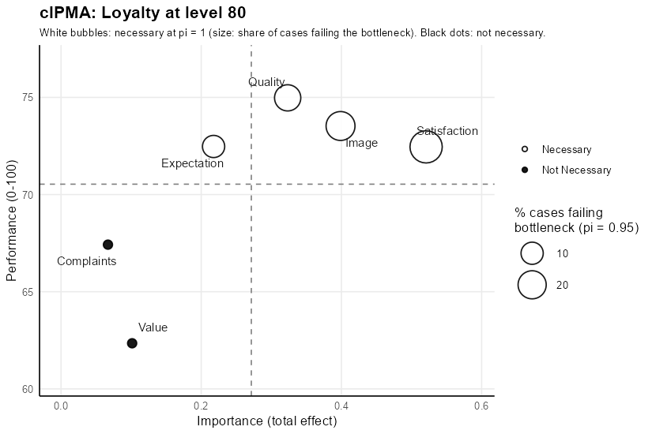
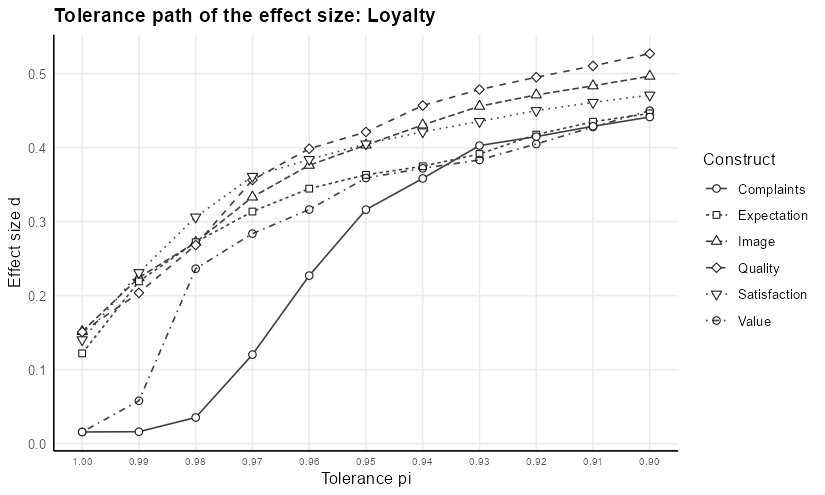

# cIPMA: Combined Importance-Performance Map Analysis

[](https://www.gnu.org/licenses/gpl-3.0)
[](https://doi.org/10.5281/zenodo.18656578)

The cIPMA package carries out the combined importance-performance map analysis of Hauff et al. (2024), <https://doi.org/10.1016/j.jretconser.2024.103723>. The analysis places each predictor of a target construct on a map of importance, the total effect in a PLS-SEM model estimated with `seminr`, against performance, the mean of the latent variable scores rescaled to 0-100. Quantile Necessary Condition Analysis (QNCA), computed with the `qnca` package, adds the necessity of each predictor and the bottleneck: the level of the predictor required for a target level of the outcome.

Necessity is decided at the strict limit `pi = 1`, where the QNCA frontier equals the CE-FDH ceiling of Necessary Condition Analysis (Dul 2016). A predictor is necessary when its CE-FDH effect size reaches 0.10 and its permutation p-value stays below 0.05. The tolerance `pi` sets the share `1 - pi` of the cases attaining the target level that may sit below the reported requirement, so a bottleneck at `pi = 0.95` rests on the 5% quantile of the predictor among the successful cases. The tolerance path repeats the effect size and the bottleneck from `pi = 1.00` to `pi = 0.90` in steps of 0.01.

The guide to the package is at <https://marekdejauj.github.io/cIPMA/>.

## Installation

The release installs from CRAN:

```r
install.packages("cIPMA")
```

The development version installs from GitHub, together with the `qnca` package from the `r` folder of its repository:

```r
remotes::install_github("MarekDejaUJ/cIPMA")
```

## Example

The example uses the `mobi` data of `seminr`: 250 customers of a mobile phone provider, with indicators on a 1-10 scale, in the European customer satisfaction index model. The target is loyalty at level 80 of 100, and the bottleneck uses the tolerance `pi = 0.95`.

```r
library(cIPMA)
library(seminr)

mm <- constructs(
  composite("Image", multi_items("IMAG", 1:5)),
  composite("Expectation", multi_items("CUEX", 1:3)),
  composite("Quality", multi_items("PERQ", 1:7)),
  composite("Value", multi_items("PERV", 1:2)),
  composite("Satisfaction", multi_items("CUSA", 1:3)),
  composite("Complaints", single_item("CUSCO")),
  composite("Loyalty", multi_items("CUSL", 1:3))
)
sm <- relationships(
  paths(from = "Image", to = c("Expectation", "Satisfaction", "Loyalty")),
  paths(from = "Expectation", to = c("Quality", "Value", "Satisfaction")),
  paths(from = "Quality", to = c("Value", "Satisfaction")),
  paths(from = "Value", to = "Satisfaction"),
  paths(from = "Satisfaction", to = c("Complaints", "Loyalty")),
  paths(from = "Complaints", to = "Loyalty")
)
pls <- estimate_pls(mobi, mm, sm)
boot <- bootstrap_model(pls, nboot = 1000, cores = 1, seed = 123)
scales <- setNames(rep(list(c(1, 10)), ncol(mobi)), names(mobi))

res <- cipma(boot, "Loyalty", mobi, scales, target_level = 80, pi = 0.95,
             seed = 1, pls_model = pls)
res
```

```text
cIPMA: target Loyalty at level 80 (n = 250, tolerance pi = 0.95)

    Construct Importance Performance     d      p Necessary Required Failing
        Image      0.399        73.5 0.151 0.0045       yes    63.57   21.6%
  Expectation      0.218        72.5 0.122 0.0155       yes    56.42   10.0%
      Quality      0.323        75.0 0.151 0.0045       yes    62.84   16.4%
        Value      0.101        62.3 0.016 0.5550        no    44.44   14.8%
 Satisfaction      0.521        72.5 0.140 0.0005       yes    67.21   29.2%
   Complaints      0.067        67.4 0.016 0.3755        no    44.44   10.8%

Necessary: CE-FDH d >= 0.10 and p < 0.05 at pi = 1.00. Required and Failing:
bottleneck at pi = 0.95 (NN: no requirement; NA: level not attained).
summary(x) adds the readings; summary(x, detail = "full") adds the tolerance path and
the bottleneck table; cipma_diagnostics(x) runs the QNCA diagnostics.
```

The columns `d`, `p` and `Necessary` give the decision at the strict limit. `Required` gives the level of each predictor required for loyalty of at least 80 at `pi = 0.95`, and `Failing` gives the share of customers below the required level. Value and complaints carry no necessity, and the map draws both as black dots.

```r
plot(res)
```



`plot(res, scale = "full")` draws the same map with performance on the whole 0-100 scale and importance from 0.

## Tolerance path

`summary(res, detail = "full")` adds the effect size and the required level at every tolerance from 1.00 to 0.90. The effect size of image grows from 0.151 at `pi = 1.00` to 0.497 at `pi = 0.90`, because the frontier rises once the tolerance admits the most efficient customers below the requirement.

```r
plot(res, type = "path")
```



Effect sizes at `pi < 1` are relative to the tolerance. The NCA landmark of 0.10 applies to the CE-FDH effect size at `pi = 1`, which is the reason the decision on necessity stays at the strict limit.

## Output

| Call | Result |
|---|---|
| `res` | combined table with the decision at the strict limit and the bottleneck at the chosen tolerance |
| `summary(res, detail = "brief")` | combined table with the settings |
| `summary(res)` | adds the PLS-SEM p-values, the effect size and p-value at the chosen tolerance and one reading per predictor |
| `summary(res, detail = "full")` | adds the tolerance path of the effect size and of the required level and the bottleneck table across outcome levels |
| `cipma_diagnostics(res)` | reference band, deletion screen, resolution table and consistency probe of QNCA for every predictor |
| `cipma_report(res, file = "report.md", diagnostics = dg)` | full report in Markdown |
| `plot(res, type = "map", scale = "zoom")` | combined map; `scale = "full"` for the 0-100 scale |
| `plot(res, type = "path")`, `plot(res, type = "bottleneck")` | tolerance paths of the effect size and of the required level |
| `check_assumptions(res)` | reliability, discriminant validity (heterotrait-monotrait ratio) and collinearity (variance inflation factor) |

## Diagnostics

```r
dg <- cipma_diagnostics(res, seed = 1)
dg
```

```text
QNCA diagnostics of the cIPMA predictors of Loyalty (tolerances 1.00, 0.95, 0.90)

Reference band (199 benchmark datasets): observed d, upper band limit, excess
    Construct   pi d_obs upper excess p_null Above_band
        Image 1.00 0.152 0.271 -0.118  0.780         no
        Image 0.95 0.404 0.466 -0.062  0.730         no
        Image 0.90 0.496 0.517 -0.021  0.460         no
  Expectation 1.00 0.123 0.225 -0.102  0.630         no
  Expectation 0.95 0.363 0.419 -0.056  0.850         no
  Expectation 0.90 0.446 0.473 -0.027  0.495         no
      Quality 1.00 0.152 0.286 -0.134  0.840         no
      Quality 0.95 0.420 0.487 -0.066  0.720         no
      Quality 0.90 0.526 0.557 -0.030  0.405         no
        Value 1.00 0.014 0.200 -0.187  1.000         no
        Value 0.95 0.358 0.418 -0.060  0.830         no
        Value 0.90 0.443 0.489 -0.047  0.640         no
 Satisfaction 1.00 0.141 0.258 -0.117  0.780         no
 Satisfaction 0.95 0.402 0.428 -0.026  0.315         no
 Satisfaction 0.90 0.471 0.494 -0.023  0.290         no
   Complaints 1.00 0.014 0.109 -0.095  0.965         no
   Complaints 0.95 0.316 0.406 -0.090  0.405         no
   Complaints 0.90 0.440 0.497 -0.057  0.575         no

Deletion screen (k = 1): most influential deletion and its relative change of d per tolerance
    Construct Cases       Relative_change Flagged_rows
        Image    28 0.191 / 0.044 / 0.007           17
  Expectation   117 0.302 / 0.010 / 0.006            5
      Quality   133 0.258 / 0.057 / 0.012           18
        Value   242 2.403 / 0.016 / 0.028           56
 Satisfaction   188 0.194 / 0.009 / 0.008            6
   Complaints   109 0.000 / 0.036 / 0.010           26

Resolution at pi = 0.95 for outcome targets up to 80
    Construct Targets Inherited Smallest_resistance Smallest_attaining_set
        Image      40         6                   5                    104
  Expectation      40        11                   5                    104
      Quality      40        10                   5                    104
        Value      40         8                   5                    104
 Satisfaction      40         2                   5                    104
   Complaints      40         3                   5                    104

Consistency probe: divergence of the drift slopes and the slopes at the two tolerances
    Construct Divergence              Drift
        Image     10.008 10.26297 / 0.25493
  Expectation      8.591  9.20613 / 0.61513
      Quality      6.953 7.89470 / -0.94169
        Value     10.615 11.37308 / 0.75806
 Satisfaction     10.156 10.55362 / 0.39722
   Complaints      6.167 6.80132 / -0.63434

An empty zone above the band exceeds the dependence-matched benchmark; the band is a
proposed diagnostic with operating characteristics still to be established.
```

The reference band compares the observed effect size with a Gaussian-copula benchmark that keeps the marginals and the rank dependence of each pair and imposes no attainability floor. An effect size above the upper limit of the band exceeds the benchmark. The band is a proposed diagnostic with operating characteristics still to be established, and the guide describes every diagnostic.

## Technology acceptance data

The combined importance-performance map analysis of Hauff et al. (2024) uses the survey of French adopters of e-book readers of Richter, Hauff, Kolev and Schubring (2023), *Data in Brief* 48, 109190, <https://doi.org/10.1016/j.dib.2023.109190>. The data are on Mendeley Data under the CC BY 4.0 licence, <https://doi.org/10.17632/pd5dp3phx2.4>, and `read.csv()` reads the file from there:

```r
tam <- read.csv(
  "https://data.mendeley.com/public-files/datasets/pd5dp3phx2/files/47b2cc21-ccde-48a1-a2af-9bcdad4e0e2f/file_downloaded",
  fileEncoding = "UTF-8-BOM", check.names = FALSE
)
tam_mm <- constructs(
  composite("Perceived_Usefulness", multi_items("PU_0", 1:3)),
  composite("Compatibility", multi_items("CO_0", 1:3)),
  composite("Ease_of_Use", multi_items("EOU_0", 1:3)),
  composite("Emotional_Value", multi_items("EMV_0", 1:3)),
  composite("Adoption_Intention", multi_items("AD_0", 1:3)),
  composite("Technology_Use", single_item("USE_01"))
)
tam_sm <- relationships(
  paths(from = c("Compatibility", "Perceived_Usefulness", "Ease_of_Use", "Emotional_Value"),
        to = "Adoption_Intention"),
  paths(from = c("Adoption_Intention", "Compatibility", "Perceived_Usefulness",
                 "Ease_of_Use", "Emotional_Value"),
        to = "Technology_Use")
)
tam_pls <- estimate_pls(tam, tam_mm, tam_sm)
tam_boot <- bootstrap_model(tam_pls, nboot = 1000, cores = 1, seed = 1)
tam_scales <- c(setNames(rep(list(c(1, 5)), 15), grep("^(PU|CO|EOU|EMV|AD)_0", names(tam), value = TRUE)),
                list(USE_01 = c(1, 7)))
tam_res <- cipma(tam_boot, "Technology_Use", tam, tam_scales, target_level = 85,
                 seed = 1, pls_model = tam_pls)
summary(tam_res, detail = "full")
```

## Structure learning

`discovery_cipma()` learns the structural model from the data with the `bnlearn` package and runs the combined analysis on the learned model. Structure learning finds statistical associations, and the learned paths need theoretical justification and replication before an interpretation as causal relations. The function is experimental.

## Citation

`citation("cIPMA")` gives the references:

- Deja, M. (2026). *cIPMA: Combined Importance-Performance Map Analysis*, R package version 0.2.0. <https://doi.org/10.5281/zenodo.18656578>.
- Hauff, S., Richter, N. F., Sarstedt, M., & Ringle, C. M. (2024). Importance and performance in PLS-SEM and NCA: Introducing the combined importance-performance map analysis (cIPMA). *Journal of Retailing and Consumer Services*, 78, 103723. <https://doi.org/10.1016/j.jretconser.2024.103723>.
- Deja, M. (2026). Quantile Necessary Condition Analysis: A Tolerance-Parameterized Generalization of Necessary Condition Analysis. *Quality & Quantity* (accepted for publication).
- Dul, J. (2016). Necessary Condition Analysis (NCA): Logic and methodology of "necessary but not sufficient" causality. *Organizational Research Methods*, 19(1), 10-52. <https://doi.org/10.1177/1094428115584005>.

## Licence

GPL-3.
